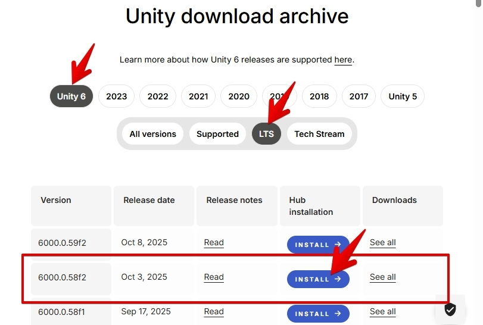
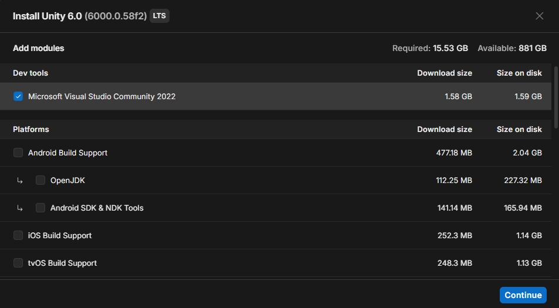
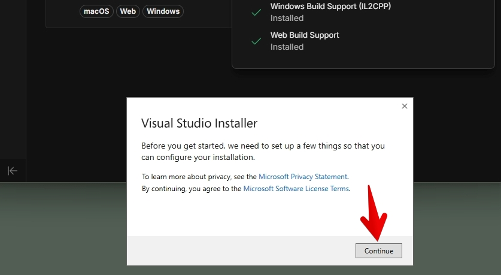
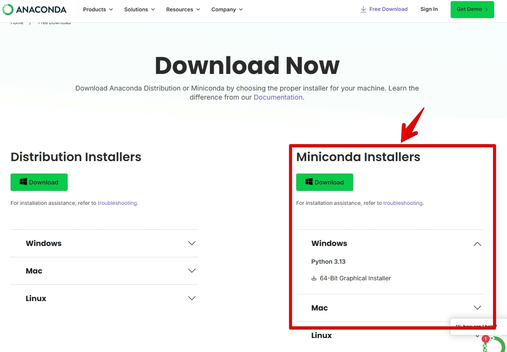
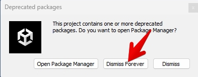
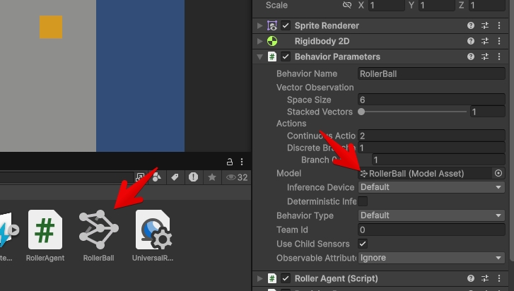
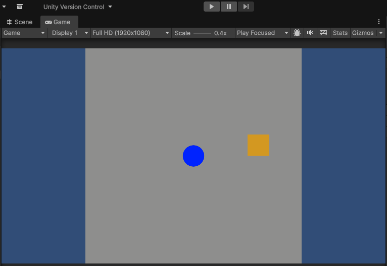

# Setup *ML-Breakout* Development environment

This document describes how to install the following development environment for *ML-Breakout*.

- Unity 6.0 LTS (6000.0.58f2)
- ML-Agents Toolkit Release 23
- Miniconda
- PyTorch, if using GPU

## Rquirements

This setup instruction was tested in the following environments:
- OS
  - Windows 11 Pro 24H2
  - macOS 15.7

## Development environment setup

Follow the steps below to set up the ML-Breakout development environment.

### Install Unity Hub

1. Create a Unity ID. You can sign up at https://login.unity.com/en/sign-in.  
We must sign in with our Unity IDs to use Unity Hub.
  
2. Download Unity Hub installer for your OS from https://unity.com/download.

3. Run the downloaded Unity Hub installer and follow the on-screen instructions.

### Install Unity Editor

1. Launch Unity Hub and sign in.

2. Visit https://unity.com/releases/editor/archive.

3. Click the install button for 6000.0.58f2 (LTS) version.



4. In the `Install Unity 6.0 (6000.58f2)` screen, select the following modules under `Add modules`, depending on your OS.

  - For Windows users:
    - Microsoft Visual Studio Community 2022
    - Mac Build Support
    - Web Build Support
    - Windows Build Support
  - For macOS users:
    - Visual Studio Code
    - Mac Build Support
    - Web Build Support
    - Windows Build Support



> **Note (Windows users)**: The Visual Studio Installer dialog may appear during installation. Click **Continue** to proceed; otherwise, the Unity Editor installation will not complete.




### Install Miniconda

1. Visit https://www.anaconda.com/download/success.

2. Download the installer for your OS.



3. Run the downloaded Miniconda installer following the installer wizard.

## Create a Conda Environment

1. Open Anaconda Prompt.
2. Run the following command to create a new Conda environment `mlagents` with Python 3.10.12:

```sh
conda create -n mlagents python=3.10.12

# Type 'a'
> Do you accept the Terms of Service (ToS) for https://repo.anaconda.com/pkgs/main? [(a)ccept/(r)eject/(v)iew]: a
> Do you accept the Terms of Service (ToS) for https://repo.anaconda.com/pkgs/r? [(a)ccept/(r)eject/(v)iew]: a
> Do you accept the Terms of Service (ToS) for https://repo.anaconda.com/pkgs/msys2? [(a)ccept/(r)eject/(v)iew]: a
> ...
> ...
> vc14_runtime       pkgs/main/win-64::vc14_runtime-14.44.35208-h4927774_10
> vs2015_runtime     pkgs/main/win-64::vs2015_runtime-14.44.35208-ha6b5a95_10
> wheel              pkgs/main/win-64::wheel-0.45.1-py310haa95532_0
> xz                 pkgs/main/win-64::xz-5.6.4-h4754444_1
> zlib               pkgs/main/win-64::zlib-1.3.1-h02ab6af_0
>
>
# Type 'y'
> Proceed ([y]/n)? y
```

## Install ML-Agents Toolkit

1. Download ML-Agents Toolkit Release 23 from https://github.com/Unity-Technologies/ml-agents/archive/refs/tags/release_23_tag.zip.

2. Extract `release_23_tag.zip` to `<repository root>/ml-agents-release_23_tag` directory.  
After extraction, the directory structure will be as follows:

```sh
.
|-- Assembly-CSharp.csproj
|-- Assets
|-- Packages
|-- ProjectSettings
|-- ml-agents-release_23_tag    # <- extract here
    |-- CODEOWNERS
    |-- CODE_OF_CONDUCT.md
    `-- ...
```

> **Note:** The project depends on this path, so make sure to place the `ml-agents-release_23_tag` directory there.

3. pen Anaconda Prompt and activate the Conda environment named `mlagents`:

```sh
conda activate mlagents
```

4. Continue the setup according to your machine learning hardware [1]:

#### If using a CPU:

1. Go to the `ml-agents-release_23_tag` directory and install `ml-agents-env` and `ml-agents` packages.

```sh
# Go to ml-agents-release_23_tag
cd <repository root>/ml-agents-release_23_tag
# Install ml-agents-env
python -m pip install --no-cache-dir ./ml-agents-envs
# Install ml-agents
python -m pip install --no-cache-dir ./ml-agents
```

#### If using a GPU:

1. Check the CUDA version supported by your GPU.
2. Find the PyTorch 2.x installation command for the CUDA version your GPU supports at https://pytorch.org/get-started/previous-versions/.
For example, if your GPU supports CUDA 12.4, the commands are:

```sh
# using conda
conda install pytorch==2.5.1 torchvision==0.20.1 torchaudio==2.5.1 pytorch-cuda=12.4 -c pytorch -c nvidia
```

> **Note:** The steps in setup.md have been tested using conda.

3. Install `PyTorch`, `ml-agents`, and `ml-agents`.

```sh
# Install PyTorch
conda install pytorch==2.5.1 torchvision==0.20.1 torchaudio==2.5.1 pytorch-cuda=12.4 -c pytorch -c nvidia
# Go to ml-agents-release_23_tag
cd <repository root>/ml-agents-release_23_tag
# Install ml-agents-env
python -m pip install --no-cache-dir ./ml-agents-envs
# Install ml-agents
python -m pip install --no-cache-dir ./ml-agents
```

## Import the *ML-Breakout* project into Unity Editor

1. Open Unity Hub.
2. Select `Projects` from the left-hand menu.
3. Click `Add` in the top-right corner and select `Add project from disk`.
4. Select the `repository root` (Unity project directory).  
After doing so, the project will appear in the `Projects` list.


## Test ML-Agents Training

### Run the training

1. Checkout `feat/initial-setup-ml-agents` branch.
2. Open the project imported in Unity Hub.  
A warning may appear stating that some packages are out of date. You can safely ignore it and click `Dismiss Forever`.



3. In Unity Editor, click `File` -> `Open Scene`.
4. Go to `<repository root>/Assets/Scenes/InitialSetupTestScene.unity` and open it.
5. In Unity Editor, click `File` -> `Build Profiles`.
6. In the `Build Profiles` screen, select your platform (`Windows` or `mac`) from the `Platforms` list on the left. Make sure it matches the OS of your Unity Editor.
7. Click `Build` in the top-right corner to execute the build.  
Specify `./Builds/<your OS>` as the output folder for the build.
7. Copy `./Docs/RollerBall.yaml` to `./ml-agents-release_23_tagconfig/sample/RollerBall.yaml`.
9. Open Anaconda Prompt and execute `mlagents-learn`.

```sh
# Go to ml-agents-release_23_tag
cd <repository root>

# For Windows
mlagents-learn .\ml-agents-release_23_tag\config\sample\RollerBall.yaml --force --run-id=test-run1 --no-graphics --env=.\Builds\windows\ml-breakout.exe

# For macOS
mlagents-learn ./ml-agents-release_23_tag/config/sample/RollerBall.yaml --force --run-id=test-run1 --no-graphics --env=./Builds/mac/ml-breakout.app

# About the parameters: 
# --force       : Overwrites existing results.
# --run-id      : ID for the training run. Results are saved under `results/<run-id>/`.
# --no-graphics : Run training without a game window to speed up the process.
# --env         : Path to the built Unity app (e.g., game-name.exe, game-name.app)
```

If you see the following output, the machine learning is running correctly.  
Press `Ctrl + C` to stop.
```sh
mlagents-learn .\ml-agents-release_23_tag\config\sample\RollerBall.yaml --force --run-id=test-run1 --no-graphics --env=.\Builds\windows\ml-breakout.exe
> ...
>             ┐  ╖
>         ╓╖╬│╡  ││╬╖╖
>     ╓╖╬│││││┘  ╬│││││╬╖
>  ╖╬│││││╬╜        ╙╬│││││╖╖                               ╗╗╗
>  ╬╬╬╬╖││╦╖        ╖╬││╗╣╣╣╬      ╟╣╣╬    ╟╣╣╣             ╜╜╜  ╟╣╣
>  ╬╬╬╬╬╬╬╬╖│╬╖╖╓╬╪│╓╣╣╣╣╣╣╣╬      ╟╣╣╬    ╟╣╣╣ ╒╣╣╖╗╣╣╣╗   ╣╣╣ ╣╣╣╣╣╣ ╟╣╣╖   ╣╣╣
>  ╬╬╬╬┐  ╙╬╬╬╬│╓╣╣╣╝╜  ╫╣╣╣╬      ╟╣╣╬    ╟╣╣╣ ╟╣╣╣╙ ╙╣╣╣  ╣╣╣ ╙╟╣╣╜╙  ╫╣╣  ╟╣╣
>  ╬╬╬╬┐     ╙╬╬╣╣      ╫╣╣╣╬      ╟╣╣╬    ╟╣╣╣ ╟╣╣╬   ╣╣╣  ╣╣╣  ╟╣╣     ╣╣╣┌╣╣╜
>  ╬╬╬╜       ╬╬╣╣      ╙╝╣╣╬      ╙╣╣╣╗╖╓╗╣╣╣╜ ╟╣╣╬   ╣╣╣  ╣╣╣  ╟╣╣╦╓    ╣╣╣╣╣
>  ╙   ╓╦╖    ╬╬╣╣   ╓╗╗╖            ╙╝╣╣╣╣╝╜   ╘╝╝╜   ╝╝╝  ╝╝╝   ╙╣╣╣    ╟╣╣╣
>    ╩╬╬╬╬╬╬╦╦╬╬╣╣╗╣╣╣╣╣╣╣╝                                             ╫╣╣╣╣
>       ╙╬╬╬╬╬╬╬╣╣╣╣╣╣╝╜
>           ╙╬╬╬╣╣╣╜
>              ╙
> 
>  Version information:
>   ml-agents: 1.2.0.dev0,
>   ml-agents-envs: 1.2.0.dev0,
>   Communicator API: 1.5.0,
>   PyTorch: 2.8.0+cpu
> ...
> [INFO] Hyperparameters for behavior name RollerBall:
>         trainer_type:   ppo
>         hyperparameters:
>           batch_size:   10
>           buffer_size:  100
>           learning_rate:        0.0003
> ...
> [INFO] RollerBall. Step: 1000. Time Elapsed: 15.306 s. Mean Reward: 0.214. Std of Reward: 0.410. Training.
> [INFO] RollerBall. Step: 2000. Time Elapsed: 21.024 s. Mean Reward: 0.194. Std of Reward: 0.395. Training.
> [INFO] RollerBall. Step: 3000. Time Elapsed: 26.739 s. Mean Reward: 0.379. Std of Reward: 0.485. Training.
> ...
```

### Test the trained model

1. Open the imported project in Unity Hub.
2. Select the `Assets` folder in the **Project** window.
3. Right-click inside the `Assets` folder and choose `Import New Asset...`.
4. Select the `./results/<run-id>/RollerBall.onnx` file.
5. Click **Import** to add the model to the `Assets` folder.
6. In the **Hierarchy** window, select `RollerAgent`, then drag and drop `RollerBall.onnx` into **Model** field under **Behavior Parameters** in the **Inspector** window.



7. Click the **Play** button at the top of the Unity Editor.  
If the setup is successful, the trained model should start playing the game.



> This test game is based on the game presented in [2] and was modified for testing purposes by a project team for learning as part of a university coursework.

## Regular Commands for Development

Before running training with ML-Agents, activate the ML-Agents conda environment:

```sh
conda activate mlagents
```

## References:

- [1] Unity Technologies, "ML-Agents 4.0 Installation," Unity Documentation, [Online]. Available: https://docs.unity3d.com/Packages/com.unity.ml-agents@4.0/manual/Installation.html#advanced-local-installation-for-development.
- [2] H. Furukawa, *Unity de Hajimeru Kikaigakushuu Kyokagakushuu: Unity ML-Agents Jissen Game Programming v2.2 Taiouban*, Tokyo: Born Digital, Inc. (in Japanese), 2022.
