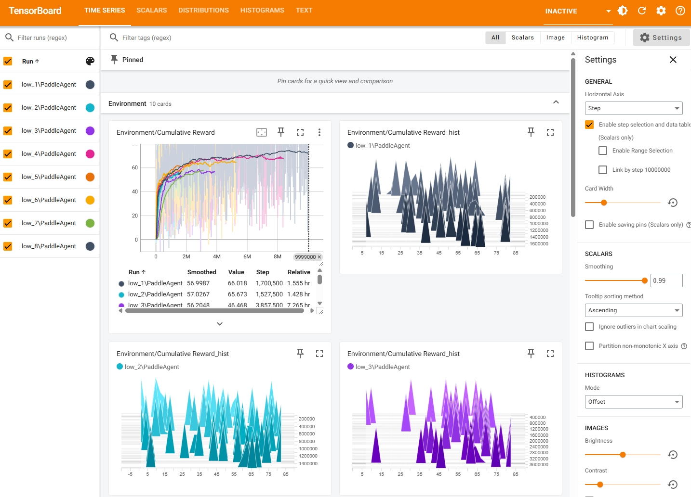

# Model Training

## View Training Logs on TensorBoard

You can view the training results in TensorBoard.



1. Install TensorBoard

```sh
# install tensorboard
conda activate mlagents
pip install tensorboard
```

2. Run TensorBoard

```sh
cd <repository root>
tensorboard --logdir=.\ml-training-scripts\log_parameters\results
... 
TensorBoard 2.20.0 at http://localhost:6006/ (Press CTRL+C to quit)
...
```

3. Open http://localhost:6006/ on a browser.

Note:
- It may take a while to load all the data.
- `Settings` -> `SCALARS` -> `Smoothing` to 0.99.

## References

- TensorBoard
    - [Using TensorBoard to Observe Training](https://docs.unity3d.com/Packages/com.unity.ml-agents@4.0/manual/Using-Tensorboard.html)
    - [TensorBoard](https://www.tensorflow.org/tensorboard)
- Parameters
    - [Training Configuration File](https://docs.unity3d.com/Packages/com.unity.ml-agents@4.0/manual/Training-Configuration-File.html)
    - [Training ML-Agents](https://docs.unity3d.com/Packages/com.unity.ml-agents@4.0/manual/Training-ML-Agents.html)

## Summary

- There was no significant difference in learning results among the parameters, `low_1` - `low_8`.
- Since the Breakout game rules are simple, parameter differences might not have a large impact on learning results.
- `Cumulative Reward` converged after approximately 3 million steps.
- `Value Loss` did not decrease for `low_3` and `low_7`, but it decreased for the other parameters.
- `low_8` showed a high `Cumulative Reward` and a gradual decrease in Value Loss, so it was used to create the low-level-difficluty model.
- Although over a million training steps were run, the paddle actually moved reasonably well after only a few tens of thousands of steps.

## Degree of difficulty

- Low Level: A level where the trained model cannot destroy all the bricks

## Create models

```sh
conda activate mlagents
cd <repository root>

# train the low-level model
mlagents-learn .\ml-training-scripts\level_low.yaml --run-id=level_low --env=.\Builds\Windows\ml-breakout.exe --no-graphics
...
[INFO] PaddleAgent. Step: 47000. Time Elapsed: 167.520 s. Mean Reward: 16.996. Std of Reward: 10.640. Training.
[INFO] PaddleAgent. Step: 48000. Time Elapsed: 170.679 s. Mean Reward: 13.069. Std of Reward: 3.256. Training.
[INFO] PaddleAgent. Step: 49000. Time Elapsed: 173.747 s. Mean Reward: 13.256. Std of Reward: 9.006. Training.
[INFO] PaddleAgent. Step: 50000. Time Elapsed: 177.765 s. Mean Reward: 17.283. Std of Reward: 11.590. Training.
[INFO] Exported results\level_low\PaddleAgent\PaddleAgent-49991.onnx
[INFO] Exported results\level_low\PaddleAgent\PaddleAgent-50027.onnx
[INFO] Copied results\level_low\PaddleAgent\PaddleAgent-50027.onnx to results\level_low\PaddleAgent.onnx.
# -> The model will be output to .\results directory.
```

